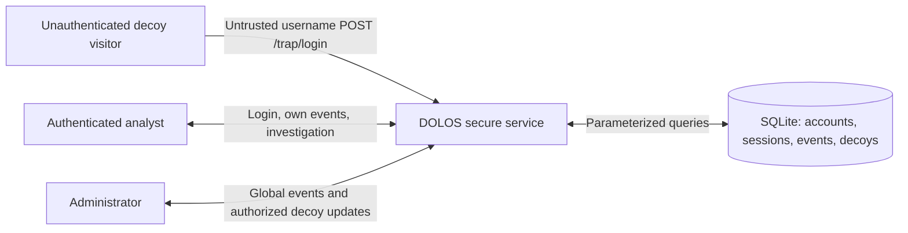
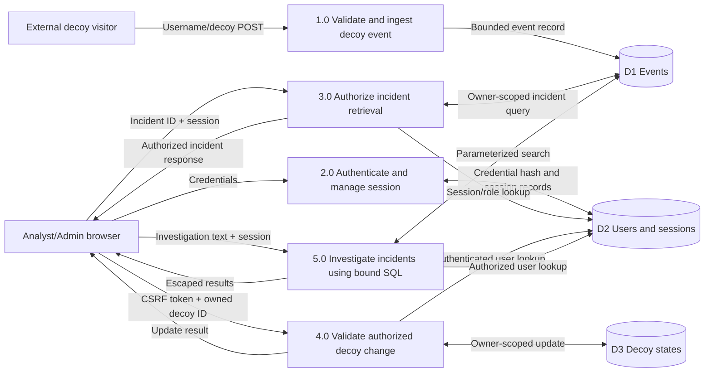

# DOLOS | Jira evidence for DLS-7, DLS-10, DLS-11 and DLS-12

**Course:** CYC386 Secure Software Design and Development, Fall 2026  
**Project:** DOLOS, Deception Operations and Log Observation System  
**Scope:** localhost-only secured application, SQLite, reviewed native parser, and intentionally vulnerable *separate* lab fixtures  
**Evidence sources:** `PNE_Report.md`, `THREAT_MODEL.pdf`, `docs/THREAT_MODEL.md`, application tests, and GitHub PRs #1–4.

> **Accuracy note:** Stakeholder needs were elicited from assumed project roles and intended use cases, not from recorded interviews. CVSS values model hypothetical unsafe versions, not measured residual scores of the hardened application. The vulnerable training service is not deployed.

## DLS-7 | Elicit stakeholder needs and map CIA

### Stakeholders and elicitation basis
- **Analyst:** read only assigned incidents, investigate safely, protect session privacy.
- **Administrator:** review global events and authorize policy/decoy updates.
- **Security operator:** maintain reliable event ingestion and trustworthy evidence.
- **Unauthenticated decoy visitor:** may submit untrusted decoy input but cannot access analyst resources.
- **Instructor/reviewer:** must reproduce safe lab demonstrations and inspect test/PR evidence.

**Method:** role-based requirements analysis, asset inventory, attack-surface review and test-derived acceptance criteria; assumptions must be validated with an actual stakeholder if access becomes available.

### Key assets and CIA
| Asset ID | Asset | Confidentiality | Integrity | Availability |
|---|---|---|---|---|
| A01 | Analyst credentials/password hashes | High | High | Supporting |
| A02 | Session hashes and CSRF tokens | High | High | Supporting |
| A03 | Synthetic event records | Medium | High | High |
| A04 | Decoy configuration | Supporting | High | High |
| A05 | Authorization decisions | High | Critical | Supporting |
| A06 | Local SQLite database | High | High | High |
| A07 | Investigation/search handler | Supporting | High | High |
| A08 | Native parser | Supporting | High | High |
| A09 | CI/CD and retained reports | Supporting | High | High |
| A10 | Container runtime and local volume | High | High | High |

The authoritative detailed inventory and rationale remain in `PNE_Report.md`.

### Traceability: protection need → CIA → threat → Jira → test
| PNE | Measurable need | CIA | Threat | Actual Jira ID | Validation |
|---|---|---|---|---|---|
| PNE-01 | Owner-scoped incident retrieval; administrator exception explicit | C, I | T-IDOR | DLS-15 | Cross-owner incident HTTP 404 and own incident HTTP 200 |
| PNE-02 | Authenticated decoy state changes require valid session CSRF token | I, A | T-CSRF | DLS-16 | Missing token HTTP 403; authorized update HTTP 303 |
| PNE-03 | User-controlled indicators never reach a shell | I, A | T-CMD | DLS-14 | Shell marker is treated as data in secure HTTP test |
| PNE-04 | Reject native event-tag input of 16 bytes or more | I, A | T-BOF | DLS-13 | ASan unsafe overflow; secure parser rejects oversized tag |
| PNE-05 | Sensitive pages deny framing via CSP and X-Frame-Options | I, C | T-FRAME | DLS-17 | Admin page anti-frame headers |
| PNE-06 | Passwords hashed and session cookies protected | C, I | T-AUTH | DLS-18 | Authentication/session regression tests and code review |
| PNE-07 | Trap logs minimum input; never records submitted password | C, I, A | T-LOG | DLS-18 | `test_trap_records_only_identifier` |
| PNE-08 | CI checks block defined high/critical findings | I, A | T-PIPE | DLS-19, DLS-20, DLS-21, DLS-22 | CI runs and security gate red/green proof |
| PNE-09 | Untrusted event values are HTML-escaped | C, I | T-XSS | DLS-18 | `test_xss_is_escaped` and HTTP probe |
| PNE-10 | Health endpoint responds 200 and container is monitored | A | T-DOS | DLS-22 | `/health` HTTP 200, Docker health=healthy |

**Acceptance evidence:** attach/link `PNE_Report.md`, above traceability, application test evidence, and the corresponding Jira work items. CIA is a prioritization of security goals, not a guarantee of perfect protection.

## DLS-10 | Context diagram and complete Level-1 DFD

**Legend:** Square/rounded nodes are external actors or processes, cylinders are data stores. Edges are named data flows. The external client-to-service boundary is untrusted; access to events and decoy configuration crosses an authenticated, owner-scoped boundary. Only the secure service is deployed.

### Context diagram

### Level-1 DFD (all five processes drawn explicitly)

**Trust boundaries:** (1) external browser to HTTP handler, (2) session/role authorization to owner-controlled resources, (3) application SQL interface to local SQLite store, (4) CI source/PR review to deployable build. The unsafe C example and localhost vulnerable web fixtures are explicitly outside the secure deployment boundary.

**Evidence:** `THREAT_MODEL.pdf` pages 1–2 and `docs/THREAT_MODEL.md`. The original PDF labels process 5.0 as an annotation rather than a process box; the diagram above provides its explicit inputs and datastore interactions.

## DLS-11 | Systematic STRIDE across DFD elements

S=Spoofing, T=Tampering, R=Repudiation, I=Information disclosure, D=Denial of service, E=Elevation of privilege. These are *plausible attack scenarios*, not claims of exploitability in the secure application.

| DFD element | S | T | R | I | D | E |
|---|---|---|---|---|---|---|
| External decoy visitor | Pretend to be another sender | Submit altered username | Deny having sent event | Request reflected private data | Flood requests | Try privileged endpoint |
| Analyst/Admin browser | Stolen identity/session | Alter request IDs/form | Deny unauthorized action | Leak cookie/incident data | Repeated queries | Claim admin privileges |
| P1 Ingestion | Spoof event source | Poison synthetic event | Missing event provenance | Echo secret input | Event flood | Reach privileged handler |
| P2 Authentication | Credential impersonation | Session/cookie manipulation | Missing durable login audit | Credential/token disclosure | Login flood | Session hijack |
| P3 Incident retrieval | Spoof user | Change requested event ID | Missing read trace | **T-IDOR** | Expensive reads | Admin/owner bypass |
| P4 Decoy control | Forged analyst | **T-CSRF** / altered state | Unlogged update | Leak enabled state | Disable decoy | Owner-filter bypass |
| P5 Investigation | Forged investigator | **T-CMD** via query | Missing query log | Query disclosure | Heavy searches | Shell execution |
| D1 Events | Spoof imported record | Change log entry | Missing audit | Read another user's event | Fill DB | Direct DB modification |
| D2 Users/sessions | Fake account/session | Alter role/hash | No identity audit | Password/session theft | Auth store outage | Promote account |
| D3 Decoy states | Fake ownership | Unauthorized toggle | No change attribution | State visibility | Turn off decoys | Owner override |
| Web response | Fake trusted UI | Clickjacking / XSS | User denies click | **T-FRAME / T-XSS** | Request amplification | Coerced privileged action |
| Native validation component | Pretend to be trusted caller | **T-BOF** input | Missing crash trace | Memory disclosure | Crash | Memory control corruption |
| CI/CD and build | Spoof commit identity | Tampered dependency/build | Missing review trail | Secret leak | Blocked build | Overprivileged workflow |

**Implemented mitigations:** salted password hashes, opaque sessions, CSRF on protected state changes, owner-scoped queries, removal of shell evaluation, bounded native parser with ASan proof, HTML encoding, CSP/XFO anti-frame controls, PR review and security gates.

**Residual:** no internet-grade TLS/reverse proxy, no rate limiting or tamper-evident audit store. `/trap/login` intentionally accepts unauthenticated submissions; its ZAP CSRF alert is recorded as a design exception, not suppressed.

## DLS-12 | Two attack trees, CVSS v3.1 and prioritized risk register

### Attack tree A: unauthorized incident/data or decoy state change

**Goal OR** — succeed through any one route below:
- **A1 IDOR (AND):** obtain analyst session + select another owner's event ID + missing object ownership check → unauthorized read. **Mitigation:** `owner_id` filter, return HTTP 404.
- **A2 CSRF (AND):** victim authenticated + victim visits hostile origin + state-changing forged POST + no valid synchronizer protection → unauthorized state update. **Mitigation:** per-session CSRF token and SameSite cookie.
- **A3 Clickjacking (AND):** attacker embeds sensitive admin page + page permits framing + user clicks sensitive control → coerced update. **Mitigation:** CSP `frame-ancestors 'none'`, X-Frame-Options DENY.

### Attack tree B: compromise processing or analyst browser

**Goal OR** — succeed through any one route below:
- **B1 Command injection (AND):** reach investigation input + insecure shell interpolation + payload separator interpreted → unintended command. **Mitigation:** no shell, bound SQL.
- **B2 Stack overflow (AND):** reach unsafe native parser + supply oversized tag + unbounded `strcpy` → memory overwrite. **Mitigation:** length check, compiler protections, ASan regression.
- **B3 Stored XSS (AND):** submit malicious event value + store it + unescaped HTML insertion → script in analyst browser. **Mitigation:** contextual HTML escaping and CSP.

### CVSS v3.1 base register (hypothetical unsafe baseline)
Values have been checked using `scripts/cvss31.py`; vectors assume stated conditions and are not post-remediation scores.

| Priority | Risk | CVSS v3.1 vector | Base | Rating | CIA impact / reason | Actual Jira ID | PR evidence |
|---|---|---|---:|---|---|---|---|
| P1 | T-CMD shell injection | `CVSS:3.1/AV:N/AC:L/PR:L/UI:N/S:U/C:H/I:H/A:H` | 8.8 | High | Potential C/I/A compromise from invoked shell | DLS-14 | #3 |
| P1 | T-IDOR unauthorized incident | `CVSS:3.1/AV:N/AC:L/PR:L/UI:N/S:U/C:H/I:H/A:N` | 8.1 | High | Hypothetical read/write impact; lab proof demonstrates read only | DLS-15 | #3 |
| P1 | T-BOF unsafe native parser | `CVSS:3.1/AV:L/AC:L/PR:L/UI:N/S:U/C:H/I:H/A:H` | 7.8 | High | Conditional memory corruption C/I/A | DLS-13 | #1, #2 |
| P1 | T-CSRF decoy-state update | `CVSS:3.1/AV:N/AC:L/PR:N/UI:R/S:U/C:N/I:H/A:L` | 7.1 | High | Integrity/availability loss with victim interaction | DLS-16 | #3, #4 |
| P2 | T-FRAME coerced admin action | `CVSS:3.1/AV:N/AC:L/PR:N/UI:R/S:U/C:N/I:H/A:N` | 6.5 | Medium | Successful coerced click assumed, not mere iframe display | DLS-17 | #3 |
| P2 | T-XSS unescaped event value | Not base-scored here | — | Further assessment | Escaped content verified, risk depends on browser/session privileges | DLS-18 | #3, #4 |
| P2 | T-PIPE pipeline tampering | Not base-scored here | — | Process risk | Mandatory reviews and scanner gates prevent untrusted changes | DLS-19–22 | #2–4 |
| Residual | T-DOS decoy flooding | Not base-scored here | — | Unresolved | Rate limiting/queueing pending | DLS-23 | Risk review |

**CVSS assumptions:** network scores presume a network-accessible vulnerable service, whereas tested fixtures are localhost-only. The native overflow proof shows a crash/memory overwrite, not demonstrated arbitrary code execution. Severity is not likelihood.

**Residual risk record:** locally hosted prototype lacks TLS and internet-grade WSGI; SQLite is not encrypted/replicated; decoy submissions can be fabricated; rate limiting, immutable logs, and high availability are pending. Record explicit acceptance/mitigation decisions in **DLS-23** before any public deployment.

## Jira close-out and evidence links

| Jira item | Attach / link | Acceptance checkpoint |
|---|---|---|
| **DLS-7** | `PNE_Report.md`, this file §DLS-7 | 10 assets, 10 PNE, CIA and validation mapped |
| **DLS-10** | `THREAT_MODEL.pdf` pp. 1–2, this file diagrams | Context and complete five-process Level-1 DFD with stores and named flows |
| **DLS-11** | `THREAT_MODEL.pdf` p. 3, this file STRIDE matrix | S/T/R/I/D/E considered across DFD elements |
| **DLS-12** | `THREAT_MODEL.pdf` pp. 4–5, this file trees/risk register | Two AND/OR attack trees, five computed CVSS vectors, real Jira IDs and PRs |

**GitHub PR references:**
- PR #1 https://github.com/Muhammad-Iqbal-Latif/SecureApp-Sprint-DOLOS/pull/1
- PR #2 https://github.com/Muhammad-Iqbal-Latif/SecureApp-Sprint-DOLOS/pull/2
- PR #3 https://github.com/Muhammad-Iqbal-Latif/SecureApp-Sprint-DOLOS/pull/3
- PR #4 https://github.com/Muhammad-Iqbal-Latif/SecureApp-Sprint-DOLOS/pull/4

**Status rule:** Only set each Jira issue to Done when its evidence link/attachment is present and its actual acceptance criteria are met. This is a traceability supplement; it does not imply an instructor conducted stakeholder interviews or approved residual-risk acceptance.
