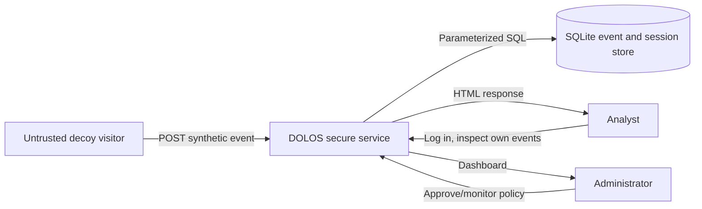
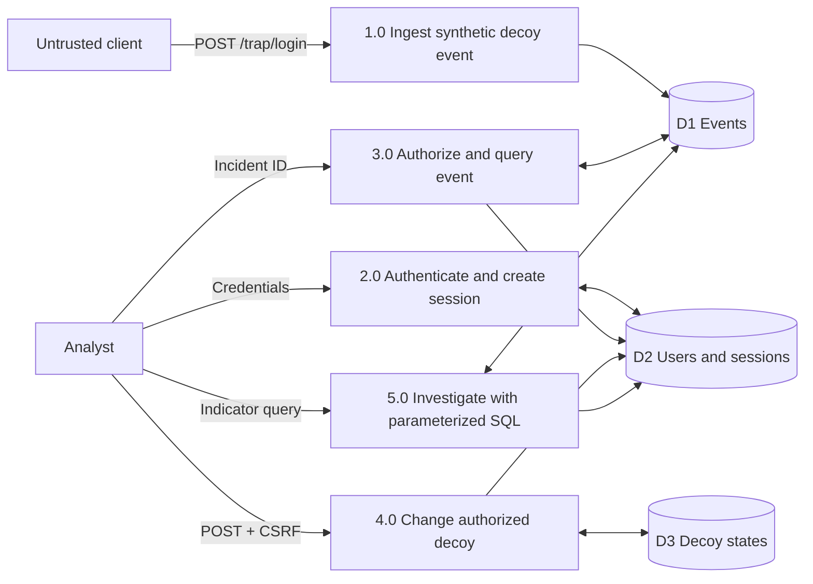

# DOLOS Threat Model (STRIDE, DFD, Attack Trees, CVSS v3.1)

## 1. Scope and trust boundaries
Local-first DOLOS secured dashboard, SQLite, analyst/admin sessions, event collector, GitHub build and local Docker runtime. A second deliberately vulnerable service at 127.0.0.1:5001 and a C lab are *test fixtures*, never deployed. Synthetic data only. The outer trust boundary is browser/untrusted HTTP client -> secured WSGI application; another boundary is authenticated user -> object-owner-scoped resources. Process -> SQLite is internal but untrusted parameters remain bound.

## 2. Context DFD

## 3. Level-1 DFD

## 4. STRIDE per DFD element
| DFD element | S | T | R | I | D | E | Controls / residual note |
|---|---|---|---|---|---|---|---|
| Untrusted decoy input | impersonated usernames | injected indicators | fake event claims | reflected event data | excessive requests | attempt privileged actions | input max, escaped rendering; **rate limit pending** |
| 2.0 authentication | stolen login token | cookie modification | no durable audit | credential leak | auth flood | session hijack | PBKDF2, opaque hashed token, HttpOnly; **TLS/rate limit pending** |
| 3.0 event retrieval | impersonated analyst | event ID tamper | missing read audit | **T-IDOR** | oversized list query | admin escalation | owner check and 404, bounded list |
| 4.0 decoy update | forged analyst | **T-CSRF** | update log incomplete | decoy state leak | disable service | owner bypass | per-session CSRF and owner WHERE clause |
| 5.0 investigation | forged query owner | **T-CMD** | inadequate query history | SQL injection | expensive search | RCE by shell | bound SQL, no subprocess; queries bounded |
| SQLite D1/D2/D3 | compromised host login | DB file changes | local tamper | offline file theft | disk full | admin host escalation | file permissions; **encryption/backups pending** |
| WSGI response | client impersonation | UI tamper | ambiguous click proof | **T-FRAME / XSS** | resource starvation | clickjacked admin | CSP + XFO, escaping; **TLS pending** |
| Native C lab fixture | malicious test input | **T-BOF** | inadequate trace | memory disclosure | crash | potential memory exploitation | bound safe parser and ASan |
| CI/CD build process | forged committer | malicious commit | missing review trail | secret leak | broken pipeline | workflow privilege misuse | code review, read-only permissions, scans |

S=Spoofing, T=Tampering, R=Repudiation, I=Information Disclosure, D=Denial of Service, E=Elevation of Privilege. Table records plausible threats per element, not a claim that every threat is currently exploitable.

## 5. Attack trees

### Attack tree A: Compromise DOLOS incident data (OR)
- Goal: read or alter an incident outside authorized ownership.
  - Path A1 [AND]: obtain low-privilege analyst session -> enumerate predictable event IDs -> **exploit missing owner check** -> retrieve another analyst record (T-IDOR).
  - Path A2 [AND]: trick authenticated analyst into visiting cross-origin page -> submit state-change request without CSRF -> alter decoy configuration (T-CSRF).
  - Path A3 [AND]: obtain browser framing capability -> embed admin page -> socially induce button click -> unauthorized change (T-FRAME).
- Controls: owner-scoped SQL; CSRF tokens; same-site cookies; CSP frame-ancestors none; XFO DENY.

### Attack tree B: Compromise DOLOS processing (OR)
- Goal: cause command execution or memory failure from untrusted event metadata.
  - Path B1 [AND]: reach indicator search with malicious input -> vulnerable code builds shell command -> inject shell delimiter -> execute unexpected command (T-CMD).
  - Path B2 [AND]: reach native metadata component -> provide >=16-byte tag -> unbounded strcpy -> overwrite adjacent stack memory -> crash or worse (T-BOF).
  - Path B3 [AND]: insert event string with HTML tags -> output renders unsafely -> script execution in analyst browser (T-XSS).
- Controls: parameterized SQL and no shell; explicit C bounds check + compiler hardening; HTML escaping and CSP.

## 6. CVSS v3.1 Base assessments (conditional vulnerable design)
Scores below are calculated using `python scripts/cvss31.py` and FIRST CVSS v3.1 Base equations. They model the hypothetical unsafe versions. They are **not** claims of currently exploitable production vulnerabilities. PR/UI choices reflect a network-accessible dashboard assumption; actual loopback demonstration exposure is lower.

| Threat | Preconditions | CVSS 3.1 vector | Base | Severity | CIA rationale |
|---|---|---|---:|---|---|
| T-BOF | Local analyst/native helper input reaches unsafe C parser | CVSS:3.1/AV:L/AC:L/PR:L/UI:N/S:U/C:H/I:H/A:H | 7.8 | High | arbitrary memory corruption could affect C/I/A; impact assumes plausible worst case, PoC proves overflow only |
| T-CMD | Authenticated analyst query reaches unsafe shell path | CVSS:3.1/AV:N/AC:L/PR:L/UI:N/S:U/C:H/I:H/A:H | 8.8 | High | shell execution may impact C/I/A, depending on process privileges |
| T-IDOR | Analyst changes incident ID without object-level authorization | CVSS:3.1/AV:N/AC:L/PR:L/UI:N/S:U/C:H/I:H/A:N | 8.1 | High | in a design permitting read/write IDOR; the current proof only shows cross-owner reading |
| T-CSRF | External forged form targets logged-in decoy operator | CVSS:3.1/AV:N/AC:L/PR:N/UI:R/S:U/C:N/I:H/A:L | 7.1 | High | configuration integrity and service availability; requires victim interaction |
| T-FRAME | User tricked into clicking iframe-embedded sensitive control | CVSS:3.1/AV:N/AC:L/PR:N/UI:R/S:U/C:N/I:H/A:N | 6.5 | Medium | framing alone does not prove a state change; impact is conditional on UI action |

**CVSS precision note:** The IDOR 8.1 score is conditional on unauthorized writes as well as reads; the implemented lab-only demonstration is a *read IDOR*, so do not represent the 8.1 as its measured realized impact. The clickjacking vector is for a successful coerced high-integrity action, not merely the ability to render an iframe. CVSS Base scores measure technical severity, not probability.

## 7. Prioritized risk register and response
| Priority | Risk / ID | CIA | Response | Jira issue | Test / PR evidence |
|---|---|---|---|---|---|
| P1 | T-CMD shell injection | C,I,A | replace shell with bound SQL search | DOLOS-12 | test_injection_string_is_only_data; PR pending |
| P1 | T-IDOR cross-owner reads | C | owner check, indistinguishable 404 | DOLOS-13 | test_unauthorized_idor_rejected; PR pending |
| P1 | T-BOF parser corruption | I,A | verify lengths, ASan test, canary | DOLOS-11 | 01/02-overflow logs; PR pending |
| P1 | T-CSRF unauthorized toggles | I,A | synchronizer token + SameSite | DOLOS-14 | test_csrf_rejects_without_token; PR pending |
| P2 | T-FRAME clickjacking | I | CSP + XFO | DOLOS-15 | header test + browser frame proof pending |
| P2 | T-XSS event content | C,I | output encoding + CSP | DOLOS-16 | test_xss_is_escaped |
| P2 | T-PIPE untrusted release | I,A | fail-on-severity CI checks | DOLOS-21 | Actions pending |
| P2 | T-DOS decoy flood | A | future per-client rate limit and queue | DOLOS-30 | accepted residual risk |

## 8. Residual risk after the implementation
- Reference WSGI server has no internet-grade hardening. Reverse proxy/TLS and production-grade server required before any public deployment.
- Local SQLite file is not encrypted; host compromise compromises event data. Ensure filesystem protections, backup and retention controls.
- Honeypot source addresses are not attested; event provenance can be spoofed and client input can be misleading.
- No rate limiting, alert prioritization, immutable audit log, SIEM integration or high-availability service.
- Docker hardening is defense in depth and does not constitute proof against container escapes.
- CVSS does not replace environment-specific risk scoring. The priority table above should be revisited after approved production design.
